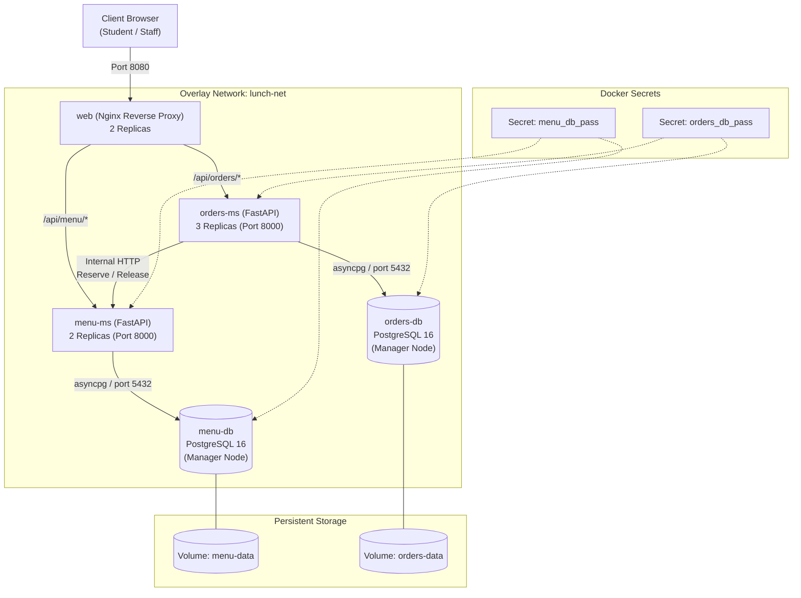

# Lunch on Time (Almuerzo a Tiempo)

> Advance lunch ordering system for the University of Cundinamarca (UdeC) Ubaté cafeteria.  
> Built with **FastAPI**, **PostgreSQL**, **Nginx**, **Docker Compose**, and **Docker Swarm**.

---

## 1. System Overview

**Lunch on Time** allows university students to browse the daily cafeteria menu, place advance lunch orders, choose a guaranteed 15-minute pickup timeslot, and monitor order status in real time without queuing. Cafeteria staff can manage the product catalog, register daily portions, adjust timeslot capacities, track orders through preparation stages, and record deliveries.

### Key Capabilities
- **Advance Ordering**: Students book orders in 15-minute pickup slots (minimum 15 minutes in advance).
- **Overbooking Prevention**: Timeslot capacities are strictly enforced using transactional advisory locks (`pg_advisory_xact_lock`), preventing race conditions.
- **Atomic Sequence Numbering**: Daily order numbers increment atomically per day across distributed microservice replicas.
- **Stock & Portions Control**: Real-time deduction and automatic "SOLD_OUT" flagging when portions reach zero.
- **Zero-Downtime Rolling Updates**: Configured with `start-first` rolling updates and health checks on Docker Swarm.
- **Fault-Tolerant Microservices**: Microservice replicas are automatically recreated by Docker Swarm if a container fails.

---

## 2. Architecture

The system follows a microservices architecture communicating over an isolated Docker overlay network (`lunch-net`).



### Components
1. **`web`**: Nginx Alpine reverse proxy serving the static web applications (`index.html` for students, `staff.html` for cafeteria staff) and routing `/api/menu/` and `/api/orders/` requests.
2. **`menu-ms`**: Microservice managing products, categories (`lunch`, `drink`, `snack`), prices, availability statuses (`AVAILABLE`, `SOLD_OUT`), and daily portion stocks.
3. **`orders-ms`**: Microservice managing student advance orders, timeslot scheduling, daily sequential numbering, delivery tracking, and cancellations.
4. **`menu-db` & `orders-db`**: Independent PostgreSQL 16 databases with dedicated named volumes and secret-managed authentication.

---

## 3. Prerequisites

- **Docker Engine** 24.0+ & **Docker Compose** v2
- **Docker Swarm** (built into Docker Engine)
- **Python** 3.12+ (for running pytest test suites and the concurrency script)
- **PowerShell** (Windows) or **Bash** (Linux / macOS)

---

## 4. Local Development with Docker Compose

Docker Compose builds images dynamically and binds individual host ports for rapid development.

### Start the Stack
```bash
docker compose up --build -d
```

### Verify Running Services
```bash
docker compose ps
```

### Access Endpoints
- **Student Portal**: [http://localhost:8080](http://localhost:8080)
- **Staff Portal**: [http://localhost:8080/staff.html](http://localhost:8080/staff.html)
- **Menu Microservice Direct**: [http://localhost:8001/docs](http://localhost:8001/docs)
- **Orders Microservice Direct**: [http://localhost:8002/docs](http://localhost:8002/docs)

### Stop Docker Compose
> [!IMPORTANT]
> Always stop Docker Compose before deploying to Docker Swarm, as both environments bind host port `8080`.
```bash
docker compose down -v
```

---

## 5. Production Deployment on Docker Swarm

In production, the system runs on Docker Swarm with 2 `web` replicas, 2 `menu-ms` replicas, 3 `orders-ms` replicas, secret management, health monitoring, and automatic failover.

> [!NOTE]
> Docker Swarm uses isolated named volumes (`lunch_menu-data` and `lunch_orders-data`), separate from Compose volumes. The stack starts with fresh, empty databases.

### Step 1: Initialize Docker Swarm
Run on the host machine to make it a Swarm manager node:
```bash
docker swarm init
```
*(If already initialized, Swarm will report that the node is already part of a swarm).*

---

### Step 2: Create Docker Secrets for Database Passwords

Pass passwords securely using Docker Secrets so sensitive credentials are never stored in plaintext environment variables.

#### On Windows (PowerShell)
To prevent Windows carriage return (`\r\n`) issues, write with `-NoNewline` before creating the secret:
```powershell
Set-Content -NoNewline -Path .\menu_pass.txt -Value "menu_prod_secret_2026"
docker secret create menu_db_pass .\menu_pass.txt
Remove-Item .\menu_pass.txt

Set-Content -NoNewline -Path .\orders_pass.txt -Value "orders_prod_secret_2026"
docker secret create orders_db_pass .\orders_pass.txt
Remove-Item .\orders_pass.txt
```

#### On Linux / macOS (Bash)
```bash
printf 'menu_prod_secret_2026' | docker secret create menu_db_pass -
printf 'orders_prod_secret_2026' | docker secret create orders_db_pass -
```

---

### Step 3: Build Docker Images Locally

For a single-node Swarm manager cluster, build the images with fixed tags:

```bash
docker build -t lunch-on-time/menu-ms:1.0 ./menu-ms
docker build -t lunch-on-time/orders-ms:1.0 ./orders-ms
docker build -t lunch-on-time/web:1.0 ./web
```

#### (Alternative) Publishing Images to GitHub Container Registry (GHCR)
For multi-node Swarm clusters where worker nodes must pull images:
```bash
# 1. Log in to GHCR with your Personal Access Token (PAT)
echo $CR_PAT | docker login ghcr.io -u <GITHUB_USERNAME> --password-stdin

# 2. Tag local images
docker tag lunch-on-time/menu-ms:1.0 ghcr.io/<GITHUB_USERNAME>/lunch-menu-ms:1.0
docker tag lunch-on-time/orders-ms:1.0 ghcr.io/<GITHUB_USERNAME>/lunch-orders-ms:1.0
docker tag lunch-on-time/web:1.0 ghcr.io/<GITHUB_USERNAME>/lunch-web:1.0

# 3. Push to GHCR
docker push ghcr.io/<GITHUB_USERNAME>/lunch-menu-ms:1.0
docker push ghcr.io/<GITHUB_USERNAME>/lunch-orders-ms:1.0
docker push ghcr.io/<GITHUB_USERNAME>/lunch-web:1.0
```
Then update the `image:` paths in `docker-stack.yml` and deploy with `--with-registry-auth`.

---

### Step 4: Deploy the Stack

Ensure Docker Compose is stopped (`docker compose down`), then deploy:
```bash
docker stack deploy -c docker-stack.yml lunch
```

---

### Step 5: Verify Services and Tasks

Check service status and replica counts:
```bash
docker stack services lunch
```
Expected output:
```text
ID             NAME              MODE         REPLICAS   IMAGE                       PORTS
...            lunch_menu-db     replicated   1/1        postgres:16                 
...            lunch_menu-ms     replicated   2/2        lunch-on-time/menu-ms:1.0   
...            lunch_orders-db   replicated   1/1        postgres:16                 
...            lunch_orders-ms   replicated   3/3        lunch-on-time/orders-ms:1.0 
...            lunch_web         replicated   2/2        lunch-on-time/web:1.0       *:8080->80/tcp
```

Inspect task placement and container health:
```bash
docker service ps lunch_orders-ms
docker service ps lunch_menu-ms
```

---

### Step 6: Scaling Services on Demand

Scale microservice replicas dynamically (e.g., during the 12:00 PM lunch rush):
```bash
docker service scale lunch_orders-ms=5
```
Verify the 5 replicas are running:
```bash
docker service ps lunch_orders-ms
```

---

### Step 7: Zero-Downtime Rolling Updates

`docker-stack.yml` configures rolling updates (`parallelism: 1`, `order: start-first`). To roll out a new image version without dropping student requests:

```bash
docker service update --image lunch-on-time/orders-ms:1.1 lunch_orders-ms
```
Swarm starts the new replica container first, waits for the `/health` check to pass, and only then terminates the old replica.

---

### Step 8: Removing the Stack
```bash
docker stack rm lunch
```

---

## 6. Automated Testing

The project includes 79 automated tests across both microservices using `pytest`.

### Run Test Suites
```bash
# Menu microservice tests (34 tests)
python -m pytest menu-ms/tests

# Orders microservice tests (45 tests)
python -m pytest orders-ms/tests
```

---

## 7. Concurrency Test Script

To verify that the system handles high-concurrency bursts across multiple replicas without duplicate order numbers or overbooking, run `scripts/concurrency_test.py`.

### How It Works
1. Validates that the Nginx gateway and microservices are healthy.
2. Selects or creates a product with **no stock limits (`stock: null`)** so rejections are solely due to timeslot capacity.
3. Sets timeslot capacity to **10** orders.
4. Concurrently fires **20 simultaneous order requests** for the **exact same timeslot**.
5. Verifies:
   - Exactly **10 orders are accepted** (`HTTP 201 Created`).
   - Exactly **10 orders are rejected** (`HTTP 409 Conflict: "La franja seleccionada está llena"`).
   - All assigned order numbers are unique and strictly sequential without race condition duplicates.

### Execution
With the stack running on `http://localhost:8080`:
```bash
python scripts/concurrency_test.py --url http://localhost:8080 --orders 20 --capacity 10
```

### Expected Output
```text
======================================================================
 LUNCH ON TIME - CONCURRENCY AND CAPACITY ENFORCEMENT TEST
======================================================================
Target:       http://localhost:8080
Total Orders: 20
Timeslot Cap: 10
----------------------------------------------------------------------
[*] Checking services health at http://localhost:8080...
    [+] All microservices are healthy and reachable.

[Step 1] Preparing test product without stock limit (stock=null)...
    [+] Registered new test product with stock=null: 'Plato Concurrencia 5432' (ID: 1)

[Step 2] Selecting timeslot...
    [+] Selected existing clean timeslot: 12:30 (Capacity: 10)

[Step 3] Dispatching 20 simultaneous orders for timeslot '12:30'...
    [+] All 20 requests completed in 0.42 seconds.

======================================================================
 TEST RESULTS & VERIFICATION
======================================================================
Total Requests:     20
Orders Accepted:    10 (Expected: 10)
Orders Rejected:    10 (Expected: 10)
Assigned Numbers:   [1, 2, 3, 4, 5, 6, 7, 8, 9, 10]
  [PASS] Accepted order count exactly matches timeslot capacity.
  [PASS] No duplicate order numbers detected (Atomic sequence verified).
  [PASS] All rejections were due to timeslot capacity exhaustion (409 Conflict).
  [PASS] Order numbers form a continuous sequential range.
----------------------------------------------------------------------
 OVERALL RESULT: CONCURRENCY TEST PASSED SUCCESSFULLY!
======================================================================
```

---

## 8. Fault Tolerance & Self-Healing Test

Docker Swarm continuously monitors container health and automatically respawns replicas if a process terminates or a node crashes.

### Step-by-Step Verification

1. **Identify the running `orders-ms` containers:**
   ```bash
   docker ps --filter "name=lunch_orders-ms"
   ```
   You will see 3 active containers.

2. **Simulate a sudden container failure:**
   Kill one of the running containers forcefully:
   ```bash
   docker kill <CONTAINER_ID>
   ```

3. **Observe Swarm's self-healing action:**
   Check the service task history:
   ```bash
   docker service ps lunch_orders-ms
   ```
   Output demonstrates automatic recovery:
   ```text
   ID             NAME                    IMAGE                         NODE       CURRENT STATE            ERROR
   abc123...      lunch_orders-ms.1       lunch-on-time/orders-ms:1.0   manager    Running 5 seconds ago    
   def456...       \_ lunch_orders-ms.1   lunch-on-time/orders-ms:1.0   manager    Shutdown 8 seconds ago   Non-zero exit (137)
   ```
   Swarm marks the killed task as `Shutdown` and automatically provisions a new replica in state `Running` within seconds.

4. **Verify uninterrupted service:**
   Throughout this failover, the Swarm ingress routing mesh and Nginx immediately redirect incoming requests to the remaining healthy replicas without user-visible errors.

---

## 9. Documentation Links

- [docs/design.md](docs/design.md): System architecture, API specifications, database design, and sprint roadmap.
- [docs/design.pdf](docs/design.pdf): Formatted architecture design specification document.
- [docs/article.pdf](docs/article.pdf): Academic paper on the cafeteria order management system.
- [docs/user-stories.xlsx](docs/user-stories.xlsx): Complete user stories and acceptance criteria traceability matrix.

---

## 10. Development Team

- **Michell Daniela Caicedo**
- **Julian Esteban Ordoñez**
- **Yenderson Julian Silva Gomez**
